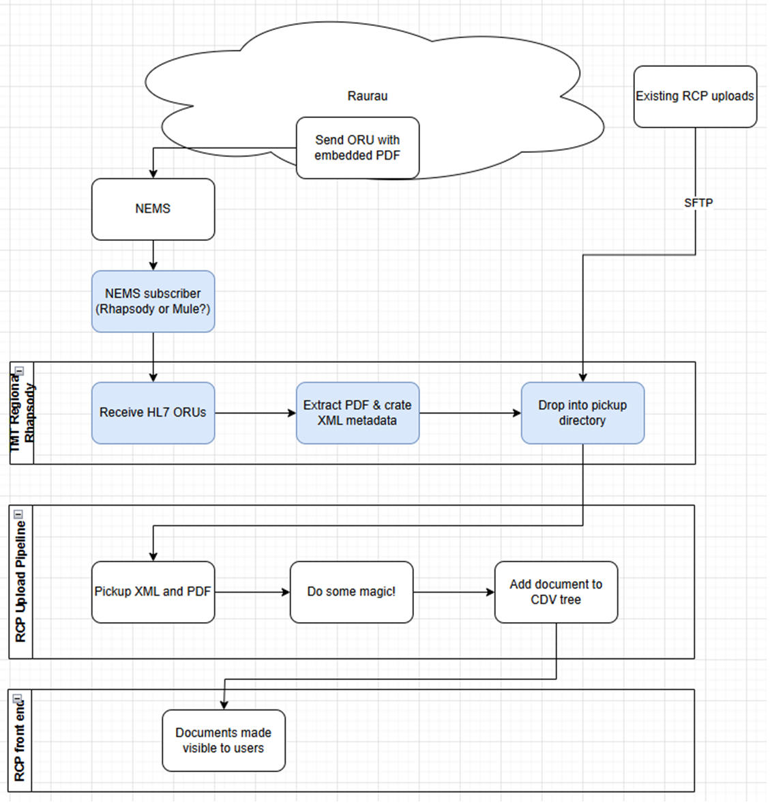

## Purpose

This is a technical design document for the generic NEMS **Treatment Summary event**.

The initial publisher system is **Raurau Ngaehe** for Oncology treatment summaries, and the subscriber systems are envisaged to be various regional clinical document repositories.

The Production deployment would ideally be completed before November 2026.

---

## Process View

### Event Process View

1. Clinician prescribes or administers medication in Raurau. These events trigger the creation of a Treatment Summary.

2. Raurau publishes to NEMS daily. The payload is an HL7 `ORU^R01` message with an embedded Base64-encoded PDF.

3. NEMS routes the event to the correct region's queue based on the ordering facility ID included in the ORU message.

4. Mule subscribes to the queue and forwards the message to TMT Regional Rhapsody, which extracts the PDF, creates XML metadata, and drops the files into the pickup directory.

5. RCP Upload picks up the PDF and XML and adds the PDF to the RCP CDV tree, where it is viewable to clinicians.



---

## Topic Taxonomy

For **Treatment Summary** events, the topic taxonomy structure follows the overall topic taxonomy structure:

```text
service-domain/resource/event/verb/version/message type/treatment type/patient health district/service request placer/treatment organisation
```

Example:

```text
delivery/procedure/treatment/summarised/v1/hl7/oncology/G00011-K/G00013-C/G00013-C
```

The topic fields are elaborated in the table below.

In the original document:

- **Dark-green** indicates root taxonomy fields.
- **Light-green** indicates event property fields.

| # | Event Topic Field | Field Type | Value | Description |
|---|---|---|---|---|
| 1 | `service-domain` | Root | `delivery` | Healthcare domain |
| 2 | `resource` | Root | `procedure` | FHIR resource reference: [Procedure](https://build.fhir.org/procedure.html) |
| 3 | `event category` | Root | `treatment` | Event category; extends FHIR [Procedure Category](https://build.fhir.org/valueset-procedure-category.html) |
| 4 | `verb (past tense)` | Root | `summarised` | Action that triggered the event |
| 5 | `version` | Root | `v1` | Starting version |
| 6 | `message type` | Event Property | `hl7`, `fhir` | Accommodates the different message formats supported by event subscriber systems. Mandatory. |
| 7 | `treatment type` | Event Property | `oncology`, `haematology`, `stemcelltransplant`, `noncancerchemotherapy` | Type of treatment. Mandatory. |
| 8 | `patient health district` | Event Property | 8 digit alphanumeric organisation identifier | HPI Organisation ID of patient's residential health district. Mandatory. |
| 9 | `service request placer` | Event Property | 8 digit alphanumeric organisation identifier | HPI Organisation ID of prescribing or ordering district for the procedure. FHIR Service Request Placer. Mandatory. |
| 10 | `treatment organisation` | Event Property | 8 digit alphanumeric organisation identifier | HPI Organisation ID where treatment was administered. Administration Site. Mandatory. |

---

## Message Header (Event Metadata)

| Header | Key Literal | Description | Required | Format / Values | Example |
|---|---|---|---|---|---|
| ID | `solace-user-property-id` | Message ID, unique for each publisher | | GUID correlation ID | `987298dd-c484-462f-a15d-f18a97267959` |
| Source | `solace-user-property-source` | Publisher URI reference | | | LAB system URI |
| Time | `solace-user-property-time` | UTC time when the message is published | | `YYYY-MM-DDTHH:MM:SS` | `2024-11-30T18:54:43Z` |
| Spec Version | `version` | Version of the CloudEvents spec | Optional | `{major}.{minor}` | `1.0` |
| Type | `solace-user-property-type` | Substring of the topic taxonomy including root to version | | `{root}/{version}` | |
| Subject | `solace-user-property-subject` | Treatment Summary document ID | | | |
| Content Type | `solace-user-property-datacontenttype` or `content-type` for REST API | Content type of event data | | FHIR: `application/json`; HL7: `application/hl7-v2` | `application/json`, `application/hl7-v2` |

---

## Message Payload

| Event | Payload Schema | 
|---|---|
| `summarised` | Full HL7 message payload. FHIR payload is to be defined.  |


### Payload Schema

```text
Full HL7 message payload including possible attachments (FHIR payload is to be defined)
```
